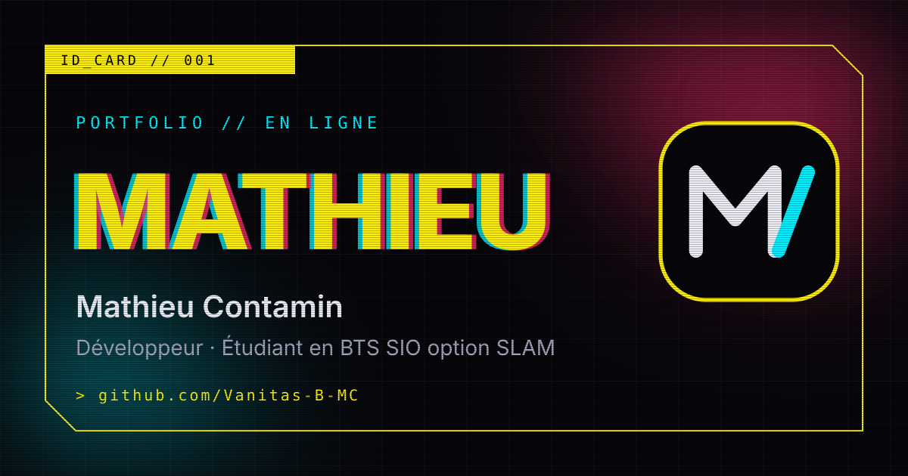

# Portfolio — Mathieu Contamin

Portfolio personnel d'un étudiant en **BTS SIO option SLAM** (Services Informatiques aux Organisations, Solutions Logicielles et Applications Métiers), en 2e année.

**Voir le site : [vanitas-b-mc.github.io](https://vanitas-b-mc.github.io)**



---

## Sommaire

- [Présentation](#présentation)
- [Fonctionnalités](#fonctionnalités)
- [Technologies](#technologies)
- [Structure du projet](#structure-du-projet)
- [Lancer le site en local](#lancer-le-site-en-local)
- [Modifier le contenu](#modifier-le-contenu)
- [Veille informatique automatique](#veille-informatique-automatique)
- [Mise en ligne](#mise-en-ligne)
- [Easter eggs](#easter-eggs)
- [Contact](#contact)

---

## Présentation

Ce site présente mon parcours, mes compétences et mes projets. Il a une identité visuelle inspirée de **Cyberpunk 2077** (jaune néon, cyan, coins coupés, effets de glitch). Il est fait entièrement à la main, sans framework ni bibliothèque externe.

Il comporte deux pages :

| Page | Contenu |
| --- | --- |
| `index.html` | Le portfolio : accueil avec fiche de profil, à propos et parcours, compétences, projets, contact et CV |
| `veille.html` | Ma veille informatique : un flux d'articles mis à jour automatiquement à partir de flux RSS |

## Fonctionnalités

- **Accueil** : présentation, fiche de profil façon « carte d'identité » et accès rapide aux projets.
- **À propos** : présentation, parcours (bac ST2S puis BTS SIO), centres d'intérêt et recherche de stage.
- **Compétences** : C#, HTML, CSS, JavaScript, PHP, SQL, Python, Git / GitHub.
- **Projets** : des cartes avec capture, description, technologies, état (terminé ou en cours) et lien vers le dépôt GitHub.
- **Contact** : e-mail, GitHub et téléchargement du CV en PDF.
- **Veille** : articles classés par catégorie (Développement, Cybersécurité, Infrastructure…), recherche par mot-clé, liste des sources et explication de la méthode.
- **Responsive** : utilisable sur ordinateur, tablette et téléphone (menu adapté sur petit écran).
- **Accessibilité** : lien « Aller au contenu », navigation au clavier, textes alternatifs, contrastes soignés, respect du réglage « réduire les animations » du système.
- **Contenu séparé du code** : tous les textes sont dans un seul fichier (`content/data.js`), la page se construit toute seule.

## Technologies

- **HTML5** sémantique
- **CSS3** (variables CSS, grilles, animations)
- **JavaScript** natif (modules ES, sans dépendance)
- **Python** pour le script de veille (bibliothèque standard uniquement)
- **GitHub Actions** pour la mise à jour automatique de la veille
- **GitHub Pages** pour l'hébergement

## Structure du projet

```
index.html                  page principale du portfolio
veille.html                 page « Veille informatique »
css/style.css               style du portfolio
css/veille.css              style de la page Veille
css/<thème>.css             thèmes secrets (voir easter-egg/README.md)
js/main.js                  construit le portfolio à partir de content/data.js
js/veille.js                affiche, filtre et recherche les articles de veille
js/theme.js                 gestion des thèmes de couleur
js/secret-supersecret.js    code secret de la 2e page cachée
content/data.js             TOUT le contenu du portfolio (textes, projets, contact…)
content/veille-sources.json liste des flux RSS suivis
content/veille.json         articles de veille (rempli automatiquement)
scripts/fetch_veille.py     relève les flux RSS et écrit content/veille.json
.github/workflows/veille.yml  lance la relève toutes les 3 heures
assets/                     favicon, images, aperçu, CV en PDF
easter-egg/                 pages et jeux cachés (voir easter-egg/README.md)
```

## Lancer le site en local

Le site utilise des modules JavaScript : il faut passer par un petit serveur local (ouvrir `index.html` directement en double-cliquant ne fonctionne pas).

```bash
git clone https://github.com/Vanitas-B-MC/vanitas-b-mc.github.io.git
cd vanitas-b-mc.github.io
python -m http.server 8000
```

Puis ouvrir [http://localhost:8000](http://localhost:8000).

L'extension **Live Server** de VS Code fonctionne aussi.

## Modifier le contenu

Tout le texte du portfolio se trouve dans **`content/data.js`** : nom, accroche, fiche de profil, paragraphes « À propos », parcours, compétences, projets, liens et CV. Il n'y a pas besoin de toucher au HTML.

Pour ajouter un projet, il suffit d'ajouter un objet dans la liste `projects` :

```js
{
  name: "Mon projet",
  description: "Ce que fait le projet.",
  category: "Projet de formation",
  status: "completed",            // ou "in-progress" (facultatif)
  tags: ["C#", "WinForms"],       // technologies (facultatif)
  image: "assets/mon-projet.png", // capture (facultatif)
  github: "https://github.com/Vanitas-B-MC/mon-projet"
}
```

## Veille informatique automatique

La page Veille se met à jour toute seule, sans serveur ni base de données :

1. Toutes les 3 heures, le workflow GitHub Actions **« Mise à jour de la veille »** (`.github/workflows/veille.yml`) se lance.
2. Il exécute `scripts/fetch_veille.py`, qui lit les flux RSS/Atom listés dans `content/veille-sources.json`, nettoie les résumés et écrit `content/veille.json`.
3. Si des articles ont changé, le workflow fait un commit (« chore(veille) : mise à jour automatique ») et GitHub Pages republie le site.

Sources suivies actuellement : LinuxFr.org, Developpez.com, LeMagIT, CERT-FR, The Register, The Hacker News, BleepingComputer, GitHub Blog.

Pour ajouter ou retirer une source, il suffit de modifier `content/veille-sources.json` (nom, adresse du flux, site, catégorie, langue).

## Mise en ligne

Le site est publié avec **GitHub Pages** depuis la branche `main`. Chaque push met le site en ligne en une à deux minutes.

> Après une mise à jour, si l'ancienne version s'affiche encore, il faut forcer le rechargement avec **Ctrl + F5** (le navigateur garde les fichiers en cache).

## Easter eggs

Le site cache plusieurs surprises : des thèmes de couleur secrets, des effets, une salle d'arcade de 17 jeux et un jeu d'action caché.
Rien n'est visible tant qu'on ne connaît pas les codes…

Tout est expliqué (attention, ça divulgue tout) dans **[easter-egg/README.md](easter-egg/README.md)**.

## Contact

- **GitHub** : [Vanitas-B-MC](https://github.com/Vanitas-B-MC)
- **E-mail** : mathieu.contamin@ellabts.com

---

© Mathieu Contamin — projet personnel réalisé dans le cadre du BTS SIO.
